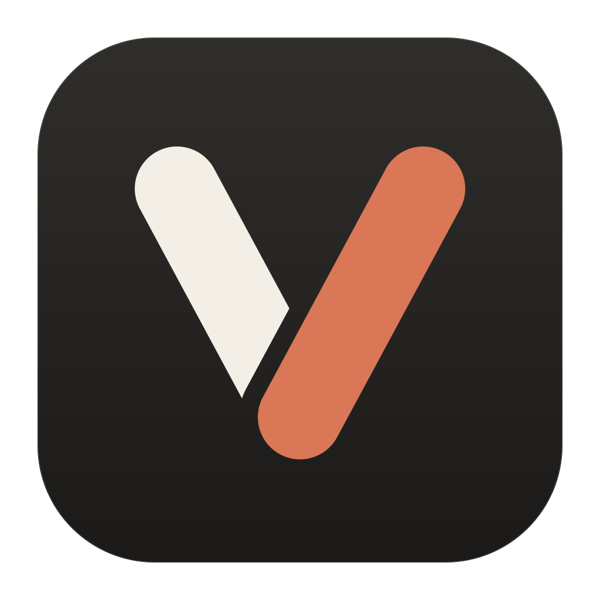
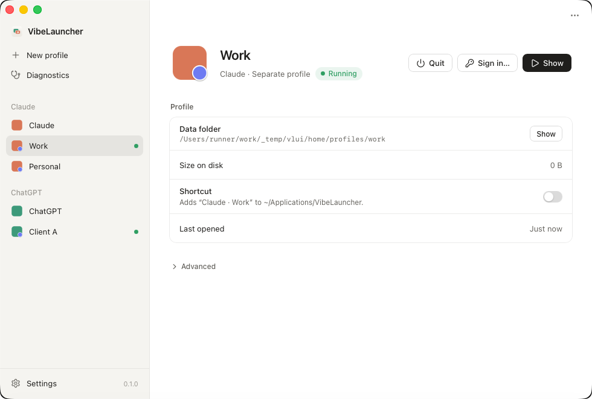

<p align="center">
  
</p>

<h1 align="center">VibeLauncher</h1>

<p align="center">
  <strong>Separate profiles for the official Claude and ChatGPT desktop apps.</strong><br>
  Work and personal, or one per client — each with its own sign-in, chats and settings.
</p>

<p align="center">
  <a href="https://github.com/Gloridust/VibeLauncher/releases"></a>
  <a href="https://github.com/Gloridust/VibeLauncher/actions/workflows/ci.yml"></a>
  
  <a href="LICENSE"></a>
</p>

<p align="center">
  <b>English</b> · <a href="README.zh-CN.md">简体中文</a>
</p>

<p align="center">
  
</p>

## Why VibeLauncher

The Claude and ChatGPT desktop apps sign in to one account at a time. VibeLauncher gives each app
as many **profiles** as you need, and every profile is a fully separate copy of the app you
already have: its own account, chats, settings and cache, side by side.

It doesn't modify, repackage or redistribute the apps, and it never reads or copies sign-in data.
Official updates keep working exactly as before.

## Features

- **Independent profiles** — run several accounts of the same app at the same time, without them
  ever seeing each other's data. Your existing setup stays as the default profile, untouched.
- **Sign-in that lands in the right place** — when you sign in through the browser, the link comes
  back to the profile you're signing in to, not whichever one the system picks.
- **One-click shortcuts** — give a profile its own entry in the app menu, Launchpad or Start menu
  and open it directly.
- **Diagnostics** — spots the things that quietly mix profiles up, such as an app that restarted
  itself after an update without its profile, and fixes them in one click.
- **Light by design** — a tiny launcher and a native window that only runs while you use it.
  Nothing stays in the background.
- **Feels at home** — light and dark themes, English and Chinese, on all three systems.

## Supported platforms

| | Claude | ChatGPT |
|---|:---:|:---:|
| **macOS** 11+ (Apple silicon and Intel) | ✓ | ✓ |
| **Windows** 10 and 11 | ✓ | ✓ |
| **Linux** (deb, rpm, AppImage) | ✓ | ✓ |

> Sign-in link handling on macOS and Windows is new. If a sign-in doesn't come back to the right
> profile, please [open an issue](https://github.com/Gloridust/VibeLauncher/issues).

## Install

Download the package for your system from
[**Releases**](https://github.com/Gloridust/VibeLauncher/releases/latest):

| System | Package |
|---|---|
| macOS | `VibeLauncher_<version>_aarch64.dmg` (Apple silicon) or `_x64.dmg` (Intel) |
| Windows | `VibeLauncher_<version>_x64-setup.exe` (installs for your user, no admin rights) |
| Linux | `.deb` or `.rpm` (recommended), or the `.AppImage` |

### Opening it the first time

VibeLauncher isn't signed with an Apple or Microsoft developer certificate yet, so your system
asks you to confirm once. After that it opens like any other app.

<details>
<summary><b>macOS</b></summary>

1. Open the `.dmg` and drag **VibeLauncher** into **Applications**.
2. Open VibeLauncher. macOS says it can't verify the developer — click **Done**.
3. Open **System Settings → Privacy & Security**, scroll down, and click **Open Anyway** next to
   the message about VibeLauncher. Confirm with your password.

If macOS says the app "is damaged and can't be opened", run this once in Terminal, then open it
again:

```bash
xattr -dr com.apple.quarantine /Applications/VibeLauncher.app
```

</details>

<details>
<summary><b>Windows</b></summary>

1. Run the `-setup.exe`.
2. If **Microsoft Defender SmartScreen** appears, click **More info**, then **Run anyway**.

</details>

<details>
<summary><b>Linux</b></summary>

Install the `.deb` (`sudo apt install ./VibeLauncher_*.deb`) or `.rpm`
(`sudo dnf install ./VibeLauncher-*.rpm`). For the AppImage, make it executable first
(`chmod +x VibeLauncher_*.AppImage`).

</details>

## Getting started

1. Open VibeLauncher and click **New profile**. Choose Claude or ChatGPT and give it a name.
2. Click **Sign in…**. The app opens with the new, empty profile — sign in there, and allow the
   browser to open the app when it asks.
3. That's it. Open the profile from VibeLauncher, or turn on **Shortcut** to launch it directly.

## FAQ

<details>
<summary><b>Is my account safe?</b></summary>

VibeLauncher never sees your password or session. Each profile signs in by itself, in the
official app, and its data stays in its own folder on your computer. VibeLauncher makes no network
requests of its own, and its log never records the codes inside sign-in links.

</details>

<details>
<summary><b>Will the official apps still update?</b></summary>

Yes. VibeLauncher only starts the app you installed; it doesn't change it. If an update restarts
an app without its profile, Diagnostics notices and restarts it correctly.

</details>

<details>
<summary><b>Where is my data, and can I move it?</b></summary>

Each profile shows its data folder on its page, with a button to open it. You can choose a
different folder when you create a profile.

</details>

<details>
<summary><b>How do I uninstall?</b></summary>

On Windows, uninstall it from Settings → Apps; links and shortcuts are cleaned up for you. On macOS
and Linux, run `vibelauncher cleanup` first, then delete the app. Your profiles and their data are
kept either way — delete a profile in VibeLauncher first if you want its data gone.

</details>

## Known limitations

- **Claude's Cowork is shared.** Its virtual machine belongs to your system account, so only one
  profile at a time can use it.
- **A few app-wide switches are shared**, such as Claude's "Open with Claude" menu entries.
- **The `codex` command in the terminal** still uses your default ChatGPT account.
- VibeLauncher relies on how the apps behave today. If an update changes that, Diagnostics will
  tell you, and a VibeLauncher update will follow.

## Contributing

Bug reports and ideas are very welcome — please
[open an issue](https://github.com/Gloridust/VibeLauncher/issues). To build it yourself or learn
how it works, see [docs/DEVELOPMENT.md](docs/DEVELOPMENT.md).

## License

[MIT](LICENSE) © 2026 Ethan Zou

<sub>VibeLauncher is an independent project. It is not affiliated with, endorsed by or supported by
Anthropic or OpenAI. "Claude" and "ChatGPT" are trademarks of their respective owners.</sub>
