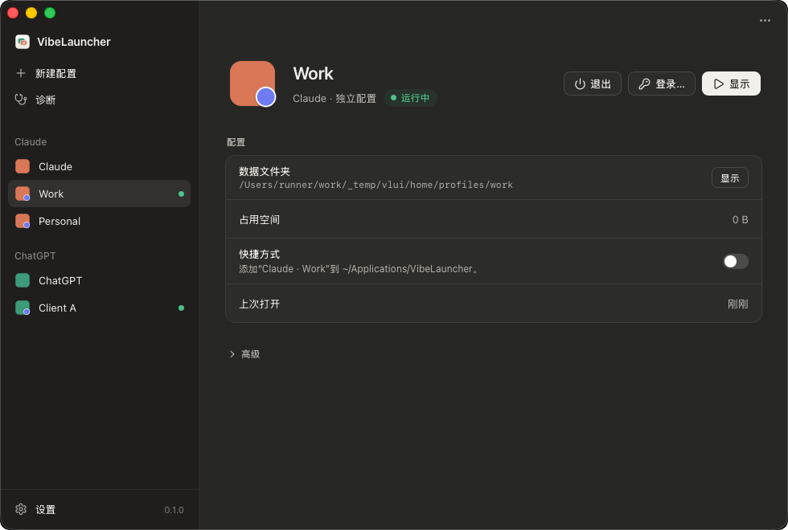

<p align="center">
  
</p>

<h1 align="center">VibeLauncher</h1>

<p align="center">
  <strong>为官方 Claude 和 ChatGPT 桌面版提供多个独立配置。</strong><br>
  工作和个人分开，或每个客户一个——各有各的登录、对话和设置。
</p>

<p align="center">
  <a href="https://github.com/Gloridust/VibeLauncher/actions/workflows/ci.yml"></a>
  <a href="https://github.com/Gloridust/VibeLauncher/releases/latest"></a>
  
  <a href="LICENSE"></a>
</p>

<p align="center">
  <a href="README.md">English</a> · <b>简体中文</b>
</p>

<p align="center">
  
</p>

## 为什么用 VibeLauncher

Claude 和 ChatGPT 桌面版同一时间只能登录一个账号。VibeLauncher 让每个应用拥有任意多个**配置**：每个配置都是你已安装应用的一份完全独立的副本，有自己的账号、对话、设置和缓存，可以同时打开。

它不修改、不重新打包、不分发官方应用，也从不读取或复制任何登录数据。官方更新照常进行。

## 功能

- **互相独立的配置**：同一个应用的多个账号可以同时运行，彼此看不到对方的数据。你原来的应用保持原样，作为默认配置。
- **登录回到对的地方**：在浏览器里登录完成后，链接会回到你正在登录的那个配置，而不是系统随便挑的一个。
- **一键快捷方式**：给配置在应用菜单、启动台或开始菜单里加一个入口，直接打开。
- **诊断**：发现那些会让配置悄悄混在一起的问题（比如应用更新后自己重启、丢了配置），一键修复。
- **轻量**：一个很小的启动器加一个原生窗口，窗口只在你使用时运行，不常驻后台。
- **原生体验**：浅色和深色主题，中文和英文，三个平台都一样。

## 支持的平台

| | Claude | ChatGPT |
|---|:---:|:---:|
| **macOS** 11 及以上（Apple 芯片和 Intel） | ✓ | ✓ |
| **Windows** 10 和 11 | ✓ | ✓ |
| **Linux**（deb、rpm、AppImage） | ✓ | ✓ |

> macOS 和 Windows 上的登录链接转交是新功能。如果登录没有回到正确的配置，欢迎[提交 issue](https://github.com/Gloridust/VibeLauncher/issues)。

## 安装

从 [**Releases**](https://github.com/Gloridust/VibeLauncher/releases/latest) 下载对应系统的安装包：

| 系统 | 安装包 |
|---|---|
| macOS | `VibeLauncher_<版本>_aarch64.dmg`（Apple 芯片）或 `_x64.dmg`（Intel） |
| Windows | `VibeLauncher_<版本>_x64-setup.exe`（只为当前用户安装，不需要管理员权限） |
| Linux | `.deb` 或 `.rpm`（推荐），或 `.AppImage` |

### 第一次打开

VibeLauncher 暂时还没有使用 Apple 或微软的开发者证书签名，所以系统会请你确认一次。之后就和其他应用一样正常打开。

<details>
<summary><b>macOS</b></summary>

1. 打开 `.dmg`，把 **VibeLauncher** 拖进“应用程序”。
2. 打开 VibeLauncher，系统提示无法验证开发者，点 **完成**。
3. 打开 **系统设置 → 隐私与安全性**，往下找到关于 VibeLauncher 的提示，点 **仍要打开**，输入密码确认。

如果提示应用“已损坏，无法打开”，在“终端”里运行一次下面的命令，再重新打开：

```bash
xattr -dr com.apple.quarantine /Applications/VibeLauncher.app
```

</details>

<details>
<summary><b>Windows</b></summary>

1. 运行 `-setup.exe`。
2. 如果出现 **Microsoft Defender SmartScreen**，点 **更多信息**，再点 **仍要运行**。

</details>

<details>
<summary><b>Linux</b></summary>

安装 `.deb`（`sudo apt install ./VibeLauncher_*.deb`）或 `.rpm`（`sudo dnf install ./VibeLauncher-*.rpm`）。使用 AppImage 时先加上执行权限（`chmod +x VibeLauncher_*.AppImage`）。

</details>

## 快速开始

1. 打开 VibeLauncher，点 **新建配置**，选择 Claude 或 ChatGPT，起个名字。
2. 点 **登录…**。应用会以这个全新的空白配置打开，在里面登录；浏览器询问是否打开应用时选择允许。
3. 完成。之后从 VibeLauncher 打开这个配置，或者打开 **快捷方式**，直接启动它。

## 常见问题

<details>
<summary><b>我的账号安全吗？</b></summary>

VibeLauncher 不会接触你的密码或登录状态。每个配置都在官方应用里自己登录，数据只保存在你电脑上它自己的文件夹里。VibeLauncher 自身不发起任何网络请求，日志也从不记录登录链接里的登录码。

</details>

<details>
<summary><b>官方应用还能正常更新吗？</b></summary>

能。VibeLauncher 只是启动你安装的应用，不改动它。如果某次更新让应用以默认设置重启了，“诊断”会发现并把它正确地重新启动。

</details>

<details>
<summary><b>数据存在哪里？能换位置吗？</b></summary>

每个配置的页面上都会显示它的数据文件夹，并可以一键打开。新建配置时可以选择别的文件夹。

</details>

<details>
<summary><b>怎么卸载？</b></summary>

Windows 上在“设置 → 应用”里卸载即可，链接和快捷方式会自动清理。macOS 和 Linux 上先运行 `vibelauncher cleanup`，再删除应用。无论哪种方式，配置和数据都会保留；如果想连数据一起删，先在 VibeLauncher 里删除对应的配置。

</details>

## 已知限制

- **Claude 的 Cowork 是共享的**：它的虚拟机属于系统账户，同一时间只有一个配置能使用。
- **少数全局开关是共享的**，比如 Claude 的“用 Claude 打开”菜单项。
- **终端里的 `codex` 命令**仍使用默认的 ChatGPT 账号。
- VibeLauncher 依赖官方应用目前的行为。如果某次更新改变了这些行为，“诊断”会提示你，VibeLauncher 也会随之更新。

## 参与贡献

欢迎反馈问题和建议，请[提交 issue](https://github.com/Gloridust/VibeLauncher/issues)。想自己构建或了解实现原理，请看 [docs/DEVELOPMENT.md](docs/DEVELOPMENT.md)（英文）。

## 许可证

[MIT](LICENSE) © 2026 Ethan Zou

<sub>VibeLauncher 是独立项目，与 Anthropic、OpenAI 无关，也未获得其认可或支持。“Claude”和“ChatGPT”是其各自所有者的商标。</sub>
